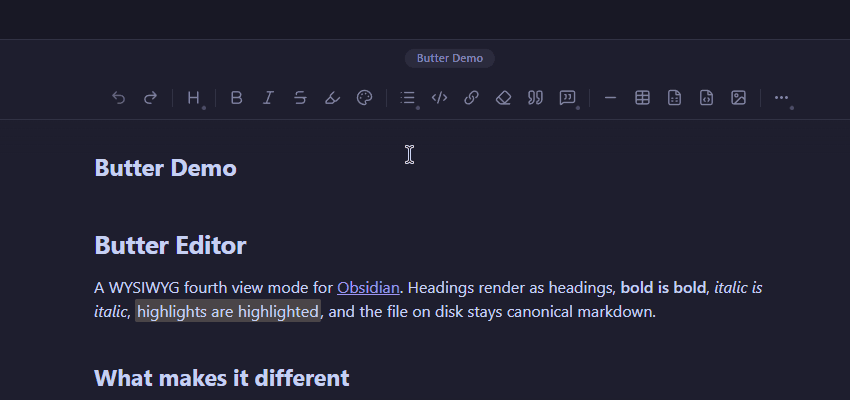
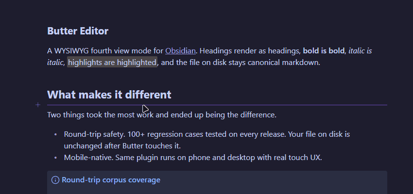
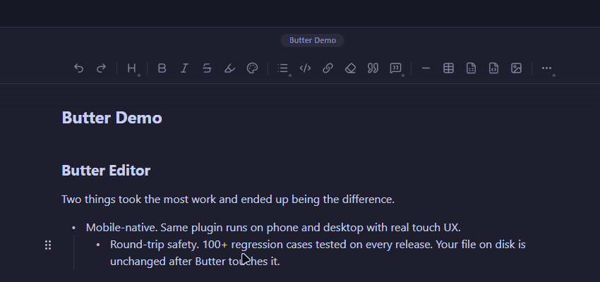
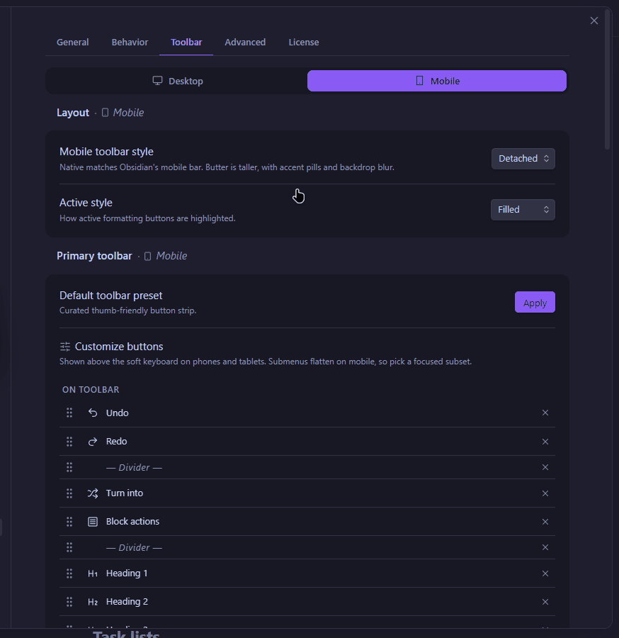

# Butter Editor

A focused WYSIWYG editing view for [Obsidian](https://obsidian.md). Butter renders supported Markdown in place while you write, without converting your notes or introducing a proprietary file format. It sits alongside Source, Live Preview, and Reading, so you can switch views whenever you like. Available on desktop and mobile.

**Butter Editor is paid software.** Try the complete editor free for 15 days - **no account, email, or payment method required**. A $16 one-time v1 license never expires, includes every v1 update plus beta access, and supports up to five active devices by default. No subscription.

[Install from Obsidian Community Plugins](https://obsidian.md/plugins?id=butter-editor) | [Pricing and purchase](https://buttereditor.com/#pricing) | [Manage license](https://licenses.buttereditor.com)

## Why Butter?

Butter adds a visual editing view to the Markdown notes already in your vault. Unlike Live Preview, it keeps supported Markdown syntax out of the editing surface while you write. Your notes remain ordinary `.md` files, with no import step and no lock-in.

## Highlights

- **Visual Markdown editing:** Format headings, lists, tasks, links, tables, code, math, callouts, and more in place.
- **Obsidian-aware:** Work with wikilinks, embeds, tags, footnotes, block IDs, properties, and Bases embeds.
- **Block editing:** Select, drag, reorder, and transform complete blocks.
- **Fast insertion:** Type `/` at the start of a block to add common blocks and Obsidian structures.
- **Desktop and mobile:** Use the same plugin and license, with controls adapted for mouse, keyboard, and touch.
- **Your toolbar, your way:** Choose its position and customize desktop and mobile button layouts.

Standard Markdown formatting is the default. Optional rich-formatting tools - text color, custom highlights, underline, and paragraph alignment - use HTML and may be less portable between Markdown applications. Enable Rich formatting under Settings → Butter Editor → Editor → Formatting to use them. Existing HTML formatting, including superscript, subscript, and alignment, is still displayed and preserved when the setting is off.

With Rich formatting enabled, use the toolbar's Alignment menu or the Align text commands to align paragraphs left, center, right, or justified, including paragraphs in lists and callouts. Choosing left restores the default and removes paragraph alignment HTML. Other alignment saves as HTML around the paragraph's Markdown; supported existing `
` and paragraph alignment HTML is editable too. Native headings retain their normal Markdown and link targets.

Obsidian's six native highlight colors are supported too. With Rich formatting off, choose a native color from the toolbar's Highlight menu. You can also write a color emoji at the start of a highlight, such as `==🔴Important==`, or use Obsidian's highlight-color commands while editing in Butter. With Rich formatting on, the toolbar offers HTML highlight presets and a custom color picker.

## See it in action

**Select, reorder, and transform blocks**

**Use context actions and optional rich formatting**

**Customize the toolbar for your workflow**

## Trial and license

The full-featured trial lasts 15 days on the installation where you start it. It does not require an account, email address, or payment card.

After the trial, Butter's editing view becomes read-only until you activate a license. Your notes are not locked: they remain ordinary Markdown files and stay available in Obsidian's other views.

A v1 license never expires and includes all v1 updates. It can be active on up to five devices by default. Use the [license portal](https://licenses.buttereditor.com) to recover a key, review active devices, or deactivate an old installation.

## Installation

Butter Editor requires Obsidian 1.7.2 or newer.

1. Open **Settings -> Community plugins**.
2. If Restricted Mode is active, select **Turn on community plugins**.
3. Select **Browse**, search for **Butter Editor**, and select **Install**.
4. Select **Enable**.

For manual installation, download `main.js`, `manifest.json`, and `styles.css` from the [latest GitHub release](https://github.com/spreadwell/butter-editor/releases/latest) and place them in `<vault>/.obsidian/plugins/butter-editor/`. Reload Obsidian, then enable Butter Editor under **Community plugins**.

## Getting started

Patch updates keep What's New available from settings without opening its page automatically. Feature releases can open it automatically according to your preference.

1. Open a Markdown note.
2. In the Command Palette, run `Butter Editor: Open current note in WYSIWYG view`.
3. On first use, complete the short setup and start the free trial or enter a license key.
4. Type `/` at the start of a block to open the insert menu. Use the view-mode button whenever you want to switch views.

## Privacy and network use

Butter does not send the contents of your notes to Butter's servers. Editing and Markdown processing happen locally.

For trial and license operations, the plugin contacts `api.buttereditor.com`. These requests can include a license key or session, a randomly generated installation ID, platform, plugin and protocol versions, and the requested activation action. The plugin sends an email address only when you request license recovery. Purchase, receipt, and account information is handled by Butter's commerce and licensing services.

Butter Editor does not send product-usage analytics, note telemetry, or third-party tracking data. See the [privacy policy](https://buttereditor.com/privacy) for full data-handling details.

The Help & feedback page can send a bug report, feature request, or other message only when you press **Submit feedback**. You can report anonymously by leaving the reply email blank and omitting personal information from your message. A save-failure notice offers recovery and an anonymous-report shortcut once per unresolved incident; opening feedback sends nothing. Basic device details and recent save diagnostics are separate choices, both off by default. You can preview exactly which save details will be sent. Automatically collected diagnostics exclude vault names, paths, filenames, note contents, raw error messages, and recovery snapshots.

Save diagnostics include failure stages, occurrence counts, content-free structural mismatch locations, and recovery outcomes. Butter keeps up to 20 recent failure groups for 30 days with the plugin in your vault configuration; your sync setup may sync this local history. Save and recovery counts cover the current plugin session. Diagnostics remain available in memory if their local history cannot be read or written, and diagnostic storage failures do not block editing or saving.

Network destinations you may need to allow through a firewall:

- `api.buttereditor.com` - trial, license, and user-submitted feedback operations
- `licenses.buttereditor.com` - browser-based license and device management

## Support

- Bug reports and feature requests: [GitHub Issues](https://github.com/spreadwell/butter-editor/issues)
- Email: [support@buttereditor.com](mailto:support@buttereditor.com)
- Billing and devices: [licenses.buttereditor.com](https://licenses.buttereditor.com)

## Source and licensing

Butter Editor is proprietary software. Its source is publicly visible for inspection, security review, and Obsidian plugin review; it is not open source. Third-party dependencies remain subject to their own license terms and are listed in [`package.json`](./package.json) and [`package-lock.json`](./package-lock.json).

See the [source license](./LICENSE) and [End User License Agreement](https://buttereditor.com/terms). Editing with Butter Editor requires a valid license or an active trial; the read-only view remains available after a trial ends.
